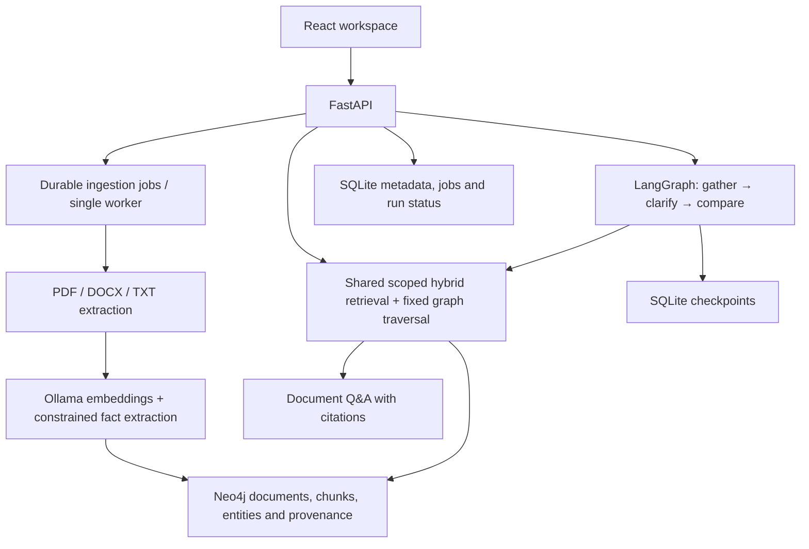

# Migration & Decommission AI

A working prototype for document-grounded application migration assessment: **one React app, one FastAPI API, Neo4j document knowledge graph, and a resumable LangGraph assessment workflow**.

Upload source, target, policy, and NFR documents; ask questions with document citations; explicitly start an assessment; answer a clarification question; review a draft target comparison and its evidence gaps.

## Run with Docker Compose

Requires Docker Compose, about 6 GB of free memory, and space for two Ollama model downloads. CPU inference works but can be slow.

```sh
git clone https://github.com/Grandhi-Aasmitha/Migration-Decommision-ai.git
cd Migration-Decommision-ai
cp .env.example .env
docker compose up --build -d
docker compose exec ollama ollama pull nomic-embed-text
docker compose exec ollama ollama pull llama3.2:3b
docker compose exec api python scripts/load_samples.py
```

On PowerShell, replace `cp .env.example .env` with `Copy-Item .env.example .env`.

- Workspace: <http://localhost:8080>
- Interactive API docs: <http://localhost:8000/docs>
- Neo4j Browser: <http://localhost:7474> (`neo4j` / the local password in `.env`)

The sample loader waits for all seven documents to finish. The first upload creates constraints, the full-text index, and the vector index. Model errors fail jobs visibly; they never silently switch to demo behavior. Re-upload a failed file to retry it.

Stop with `docker compose down`. Named volumes preserve files, metadata, graph evidence, and paused assessments. Run a **single API process** for this prototype.

## Fast local demo (without Neo4j or model downloads)

Requires Python 3.11+ and Node 22+. This is an explicit demonstration adapter: the graph is in memory, embeddings use token hashing, extraction recognizes the fixture's fixed fact lines, and answers are extractive. It exercises the real API, React UI, and LangGraph checkpoints. It is not semantic GraphRAG validation.

From the repository root:

```sh
python -m venv .venv
# Windows PowerShell: .\.venv\Scripts\Activate.ps1
# macOS/Linux: source .venv/bin/activate
python -m pip install -r backend/requirements.lock
```

Create `.env` containing:

```dotenv
GRAPH_BACKEND=memory
MODEL_PROVIDER=demo
DATA_DIR=./data
EMBEDDING_DIMENSIONS=768
```

Start the API in terminal one:

```sh
python -m uvicorn app.main:create_app --factory --app-dir backend --host 127.0.0.1 --port 8000
```

In terminal two, with the virtual environment active:

```sh
python scripts/load_samples.py
cd frontend
npm ci
npm run dev
```

Open <http://localhost:5173>. Vite proxies `/api` to FastAPI. For a real local graph/model setup, copy `.env.example` instead, start Neo4j and Ollama, and pull the models above. `GRAPH_BACKEND=neo4j` and `MODEL_PROVIDER=demo` can also test Neo4j without an LLM; use a separate database/Compose project from the Ollama corpus.

## Try the complete workflow

1. Load the seven synthetic samples, or upload 5–10 text-based documents with application ID, document type, and version. Use `_shared` only for cross-application policy/NFR documents. Use separate application IDs for source and targets.
2. Select `ledger-core`. Ask **“What systems does Ledger Core depend on?”** Open a citation and inspect its exact excerpt or original file.
3. Select targets or leave all unchecked to compare up to five ready targets. Click **Run assessment**. Ordinary document questions never start assessments.
4. Choose a priority when the assessment pauses. Balanced coverage favors Atlas; integration coverage favors Nova in the synthetic corpus.
5. Inspect matches, missing evidence, score explanation, policy/NFR excerpts, and open checks. Reopen a run from history after refreshing the page. A paused run survives API restart.

Only uploading source documents is valid. The resulting assessment reports that target comparison is not yet possible.

## Architecture



`backend/app/graph.py` owns a fixed, inspectable schema:

```text
(Document)-[:HAS_CHUNK]->(Chunk)
(Chunk)-[:MENTIONS]->(Application | System | Capability | Policy)
(Application)-[:DEPENDS_ON]->(System)
(Application)-[:HAS_CAPABILITY]->(Capability)
(Application)-[:MUST_MEET]->(Policy)
```

Each assertion has document ID, chunk ID, exact supporting quote, and page or section. PDF citations retain real page numbers; DOCX/TXT citations use sections because their page layouts are not stable. The original uploaded file is available from the citation. Documents and chunks use deterministic IDs; content hash + application ID + type + version identify an upload. Identical uploads reuse their job and graph evidence. Different versions remain separate, active evidence; use a clean corpus when comparing revisions.

The Neo4j write is a transaction: retrying a document replaces its chunks and assertions atomically. Metadata marks it ready only after the graph write succeeds. On restart, queued/processing jobs are retried from their saved files. In-memory demo evidence is rebuilt from saved uploads. SQLite stores metadata/status and LangGraph checkpoints, not the production document graph or vectors.

The shared retrieval service fuses full-text and vector rankings using reciprocal rank fusion and expands two graph hops around retrieved applications. Queries filter by application/document type and include applicable `_shared` policy/NFR evidence. An exact scoped vector fill avoids an underfilled approximate search on a small corpus. Every Cypher statement is authored in code; model outputs never become executable queries.

This implementation uses the pinned **Neo4j driver directly**, behind its own graph/ingestion interface, instead of depending on the experimental knowledge graph builder. The fixed schema and provenance validation are explicit and testable. See the official [Neo4j GraphRAG retrieval guide](https://neo4j.com/docs/neo4j-graphrag-python/current/user_guide_rag.html) for a future retriever adapter.

Ollama uses [the embedding endpoint](https://docs.ollama.com/api/embed) and [schema-constrained chat](https://docs.ollama.com/api/chat). Extracted quotes must appear in the source chunk. Generated Q&A citation IDs must belong to retrieved evidence. These checks reject unsupported source references; human review is still required for the answer's interpretation.

## Assessment behavior

The workflow uses actual LangGraph `interrupt()` and `Command(resume=...)` with a SQLite checkpointer and stable run/thread IDs, following [LangGraph interrupts](https://docs.langchain.com/oss/python/langgraph/interrupts).

- **Gather:** retrieve source/target/policy evidence through the shared service and collect all scoped source/target graph facts for the rubric.
- **Clarify:** pause for balanced, capability, or integration priority unless supplied when starting a run.
- **Compare:** rank documented capability and integration name matches. Balanced weights are 70/30; capability weights 90/10; integration weights 40/60. Missing source dimensions are excluded and weights renormalized. Ties do not produce a preferred target.
- **Report:** show exact facts, citations, target gaps, and open policy/NFR checks. Scores measure documented coverage, **not migration readiness**. Matching obligation names do not establish compliance. No shutdown or automatic decommissioning takes place.

With deterministic demo extraction, sample expectations are Atlas 90% / Nova 77% for balanced coverage, and Atlas 80% / Nova 87% for integration priority. Generative extraction can vary; review extracted facts and the sample acceptance guide before treating results as accepted.

## API

| Method and path | Purpose |
| --- | --- |
| `POST /documents` | Multipart `file`, `document_type`, `application_id`, `version`; returns document and job ID |
| `GET /documents` | List document metadata and ingestion statuses |
| `GET /ingestion-jobs/{id}` | Read queue/processing stage, ready or failed status |
| `GET /documents/{id}/chunks` | Inspect processed passages and locations |
| `GET /documents/{id}/content` | Read the uploaded original |
| `POST /chat/messages` | Scoped Q&A; `question`, `application_id`, optional `document_types`, `top_k` |
| `POST /assessments` | Start a run; `application_id`, optional `target_ids` and `objective` |
| `GET /assessments` | Recent runs for the history selector |
| `GET /assessments/{id}` | Status, current step, clarification, result and error |
| `POST /assessments/{id}/answers` | Resume a paused run with `objective` |
| `GET /health` | API/graph availability and explicit demo/provider mode |

Uploads use [FastAPI UploadFile](https://fastapi.tiangolo.com/tutorial/request-files/). Files are streamed to disk, capped at 15 MB, and limited to 500 chunks. Scanned and encrypted PDFs fail with a useful job error. Polling provides progress without streaming infrastructure.

## Verification

```sh
cd backend
python -m pytest -q
cd ../frontend
npm ci
npm run build
npm audit --audit-level=high
```

The unit/API suite checks real PDF and DOCX extraction, provenance, deduplication, failed-job retry, application scoping, unsupported model quotes/citations, source-only behavior, priority-sensitive rankings, and durable clarification across API recreation.

The Neo4j integration test runs against a **disposable database** and clears its graph. Set `NEO4J_TEST_URI` and `NEO4J_TEST_PASSWORD` only for that disposable instance. CI starts its own Neo4j 5.26 container and runs the full suite plus the TypeScript production build and npm audit. LLM inference requires separately downloaded Ollama models and is not claimed by the deterministic tests.

## Prototype boundaries

- Local, single-user development only; ports bind to loopback. Authentication, tenant isolation, virus scanning, OCR, deployment hardening, and a production task queue are not included.
- One API process owns the ingestion/assessment workers. Paused assessments persist. A process crash during active assessment execution marks that run failed on startup; start a fresh run. Running ingestion jobs recover automatically.
- Corpus size is intentionally small. Full-text/vector candidates are scoped after index search; a much larger corpus needs partitioned indexes or scope-native retrievers and better recall evaluation.
- Embedding profiles are recorded in Neo4j. Changing provider/model/dimensions requires a fresh graph database and re-ingestion; never mix vectors from different models. Keep metadata/files aligned with that database.
- Exact capability/integration name matching is transparent but conservative. Synonyms, conflicting versions, costs, migration sequencing, regulatory interpretation, policy compliance, and NFR test evidence require review.
- The included data are synthetic. Team agreement on expected answers/assessment quality is an acceptance activity described in [docs/acceptance.md](docs/acceptance.md).

See [docs/architecture.md](docs/architecture.md) for inspection queries and recovery details.
